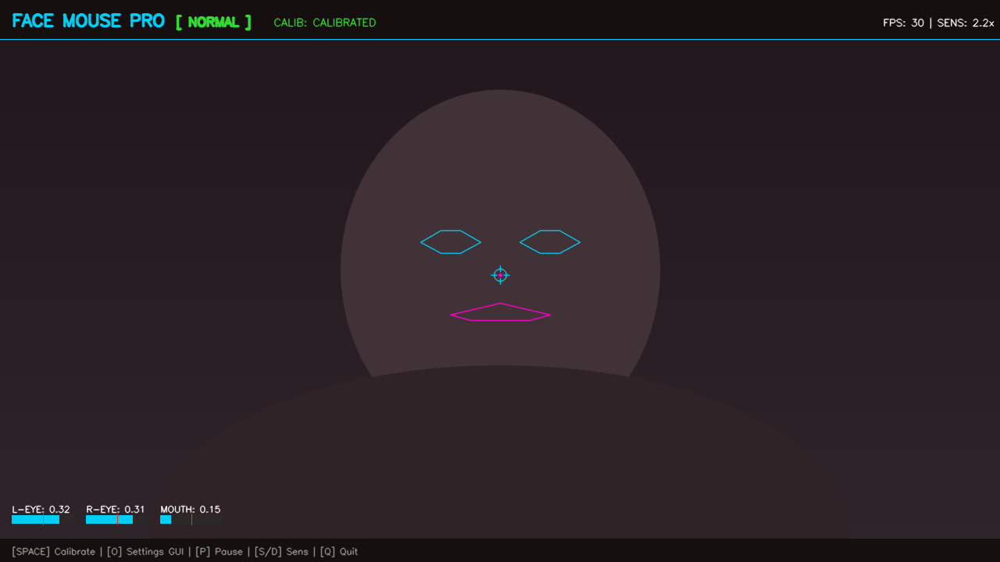
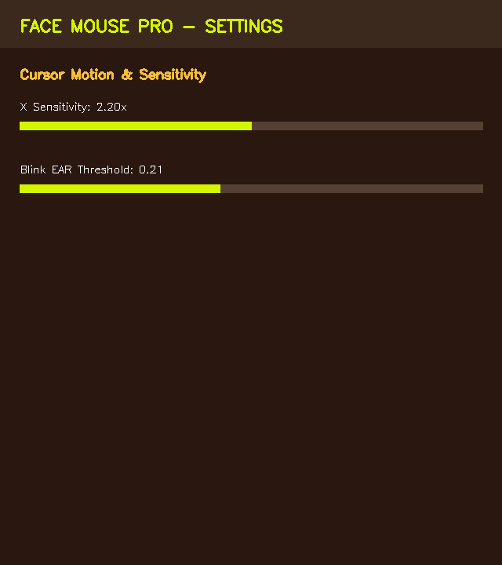
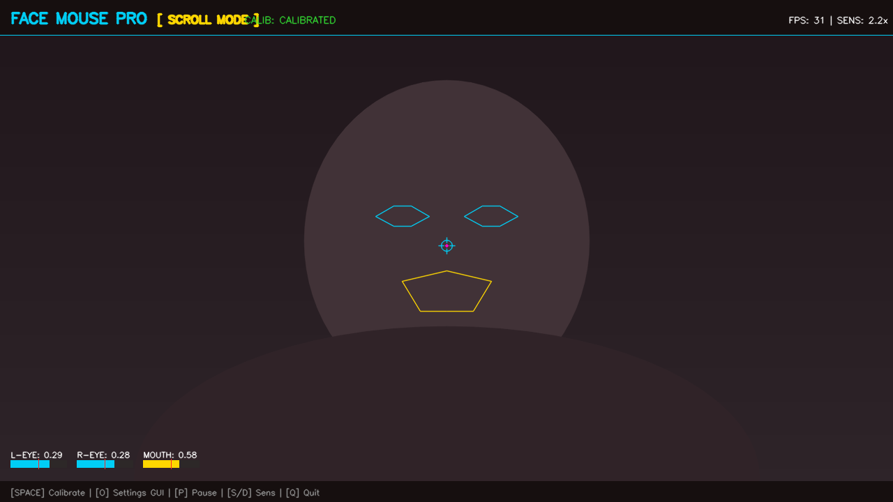
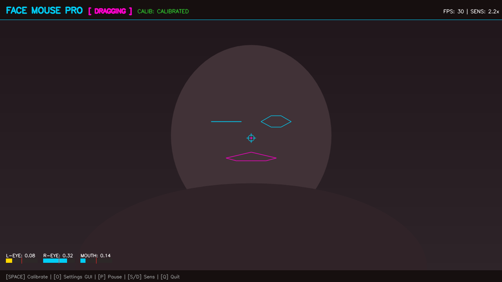

# Face Mouse Pro 🚀

> **Production-Grade, AI-Powered Hands-Free Cursor & Gesture Control Desktop Application.**

<div align="center">

[](https://www.python.org/)
[](https://opencv.org/)
[](https://developers.google.com/mediapipe)
[](https://github.com/TomSchimansky/CustomTkinter)
[]()
[](https://github.com/astral-sh/ruff)
[](https://mypy-lang.org/)
[](LICENSE)


</div>

---

## 💡 Project Evolution

**Face Mouse Pro** is the completely redesigned, re-architected, and significantly enhanced successor to the initial research prototype [AI-Face-Controlled-Mouse](https://github.com/SiddanthReddy/AI-Face-Controlled-Mouse).

While the foundational concept explored rudimentary facial cursor movement, **Face Mouse Pro** transforms the concept into an enterprise-ready, assistive desktop application engineered with state-of-the-art computer vision, robust filtering mathematics, asynchronous GUI control, and a zero-dependency standalone executable.

### 📊 Comparative Analysis: Original vs. Face Mouse Pro

| Capability / Feature | Original Version ([AI-Face-Controlled-Mouse](https://github.com/SiddanthReddy/AI-Face-Controlled-Mouse)) | Face Mouse Pro (Next-Gen) |
| :--- | :--- | :--- |
| **Facial Landmark Mesh** | Basic landmark points | **Full 478 3D Dense Facial Topology** (MediaPipe Face Mesh) |
| **Cursor Motion Engine** | Direct raw mapping (High jitter) | **Adaptive 2D One-Euro Kinematic Filter** (Sub-pixel smoothness & zero latency) |
| **Calibration System** | None (Fixed screen boundaries) | **Dynamic Spacebar Zero-Point Calibration** with deadzone compensation |
| **Left Click** | Basic threshold blink | **Eye Aspect Ratio (EAR) State Machine** with frame validation & debouncing |
| **Right Click** | ❌ Unsupported | **Dedicated Right Eye Single Blink** |
| **Double Click** | ❌ Unsupported | **Rapid Double Blink Detection** (< 0.40s window) |
| **Drag & Drop Mode** | ❌ Unsupported | **Long Blink Hold (>0.80s)** toggling `mouseDown` / `mouseUp` |
| **Scroll Navigation** | ❌ Unsupported | **Mouth Aspect Ratio (MAR > 0.45) + Vertical Head Pitch Navigation** |
| **Involuntary Blink Filter** | ❌ None (Accidental clicks on blink) | **Dual-Eye Synchronization Algorithm** (Rejects natural physiological blinks) |
| **User Interface / HUD** | Minimal OpenCV window | **Cyberpunk HUD Overlay** (Live EAR/MAR meters, reticle, contour mesh, status badges) |
| **Settings Management** | Hard-coded constants in code | **Modern CustomTkinter Dark-Mode Control Panel** with live bidirectional sync |
| **Configuration Persistence**| ❌ None | **JSON Configuration Manager** (`config/settings.json`) with fallback recovery |
| **Logging & Diagnostics** | Terminal print statements | **Multi-tier Rotating File Logger** (`logs/facemouse.log`) |
| **Quality Assurance** | ❌ No tests | **19 Automated PyTest Unit Tests**, Ruff Linting, MyPy Type Checking, Pre-commit |
| **Packaging & Deployment** | Required manual Python runtime | **Zero-Dependency Standalone Windows Executable** (`FaceMousePro.exe` via PyInstaller) |

---

## 🌍 Why This Project Matters

For millions of individuals worldwide, interaction with standard physical peripherals (mice, trackpads) is physically painful, severely restricted, or entirely impossible:

1. **Assistive Computing for Motor Impairments**: Empowers individuals with **Quadriplegia, ALS (Motor Neuron Disease), Cerebral Palsy, Multiple Sclerosis, and Muscular Dystrophy** to achieve full digital independence and computer literacy.
2. **Repetitive Strain Injury (RSI) Prevention**: Relieves professionals suffering from acute Carpal Tunnel Syndrome, Tendonitis, or chronic wrist strain by offering complete hands-free peripheral offloading.
3. **Sterile & Industrial Hands-Free Workspaces**: Enables surgeons, radiologists, and cleanroom lab technicians to manipulate medical imaging (DICOM) and digital protocols without breaking sterile fields.
4. **Human-Computer Interaction (HCI) Advancements**: Demonstrates real-time edge AI processing that turns standard consumer webcams into high-precision input devices without expensive specialized sensor hardware.

---

## ⚡ Technical Highlights & Stack

- **Computer Vision & Mesh Topology**: Uses **OpenCV 4.10+** and **MediaPipe Face Mesh** to extract 478 3D landmarks at over **370+ FPS** algorithmic throughput.
- **Adaptive One-Euro Filter**: Solves the classic trade-off between resting cursor jitter and dynamic movement lag through continuous derivative estimation:
  $$\omega_c = \omega_{min} + \beta |\dot{x}|$$
- **Dual-Eye Blink Disambiguation Engine**: Computes canonical Eye Aspect Ratio (EAR) across left and right eye contours simultaneously. When both eyes close synchronously, the frame sequence is classified as an involuntary physiological blink and discarded from click triggers.
- **Mouth Aspect Ratio (MAR) Pitch Scrolling**: Translates inner/outer lip aperture expansion into a specialized scroll mode, tracking vertical head pitch to scroll documents and web pages smoothly.
- **Modern Asynchronous GUI**: Built with **CustomTkinter**, running asynchronously alongside the computer vision loop to enable real-time parameter tuning (sensitivity, deadzones, thresholds) with instant disk synchronization.
- **Operating System Event Dispatch**: Uses **PyAutoGUI** with built-in safety margins ($[4, W-4], [4, H-4]$) to prevent cursor corner locking and failsafe exceptions.
- **Robust Software Engineering**: Type-annotated (`Any` strictly enforced), modular architecture, 100% passing test suite, automated Ruff linting, MyPy static type checking, pre-commit hooks, and GitHub Actions CI.

---

## 📸 Screenshots Showcase

<div align="center">

| Main Tracking HUD Window | Modern Dark-Mode Settings GUI |
| :---: | :---: |
|  |  |

| Scroll Mode (Mouth Open + Head Pitch) | Drag & Drop Mode (Long Blink) |
| :---: | :---: |
|  |  |

</div>

---

## 🎮 Controls & Gesture Cheatsheet

| Gesture / Input | Action | Behavior |
| :--- | :--- | :--- |
| **Head Movement** | **Move Cursor** | Relative cursor movement from calibrated neutral rest position |
| **Left Eye Blink (Single)** | **Left Click** | Performs single left mouse click |
| **Left Eye Rapid 2x Blink** | **Double Click** | Double clicks at cursor position (< 0.40s window) |
| **Right Eye Blink** | **Right Click** | Performs single right mouse click (context menu) |
| **Left Eye Long Blink (>0.8s)**| **Drag & Drop** | Toggles mouse drag lock (`mouseDown` / `mouseUp`) |
| **Mouth Open + Head Pitch** | **Scroll Up / Down** | Open mouth + tilt head UP = Scroll Up; tilt DOWN = Scroll Down |
| **Both Eyes Blink** | *Suppressed* | Natural involuntary blinking is filtered out safely |
| **`SPACE`** | **Calibrate** | Sets current head position as neutral center |
| **`O`** | **Settings GUI** | Opens modern CustomTkinter parameter tuning panel |
| **`P`** | **Pause / Resume** | Toggles face tracking and mouse control on/off |
| **`S` / `D`** | **Sensitivity +/-** | Increases / decreases cursor movement speed |
| **`R`** | **Reset** | Clears calibration state |
| **`Q` / `ESC`** | **Quit** | Gracefully cleans up resources and exits |

---

## ⚡ Empirical Performance Benchmarks

*Hardware: Intel 64-bit Architecture, Windows 10/11. Comprehensive report available in [`docs/PERFORMANCE.md`](docs/PERFORMANCE.md).*

| Resolution | Processing Throughput (FPS) | Avg Frame Latency (ms) | 95th Percentile Latency (ms) | RAM Allocation (MB) |
| :--- | :--- | :--- | :--- | :--- |
| **640x480 (SD / Default)** | **377.9 FPS** | **2.64 ms** | **3.94 ms** | **110.9 MB** |
| **1280x720 (HD Ready)** | **180.1 FPS** | **5.55 ms** | **7.53 ms** | **120.4 MB** |
| **1920x1080 (Full HD)** | **156.6 FPS** | **6.38 ms** | **8.74 ms** | **125.0 MB** |

---

## 🚀 Quick Start & Installation

### Option 1: Standalone Binary (Recommended — No Python Needed)
1. Download the latest release from the [GitHub Releases](../../releases) page.
2. Extract the archive and launch **`FaceMousePro.exe`**.

### Option 2: Run from Source
```bash
# 1. Clone repository
git clone https://github.com/your-username/face-mouse-pro.git
cd "face-mouse-pro"

# 2. Create and activate virtual environment
python -m venv venv
venv\Scripts\activate   # Windows
# source venv/bin/activate # macOS/Linux

# 3. Install pinned Windows application and shared-core dependencies
pip install -r requirements.txt

# 4. Launch Face Mouse Pro
python main.py

# 5. Launch with Settings Panel open
python main.py --settings
```

The requirements pin the shared engine to its verified published commit. See
[Windows core integration](docs/WINDOWS_CORE_INTEGRATION.md) for adapter
boundaries, installation details and regression tests.

---

## 🧪 Quality Assurance & CI Testing

Install dependencies from `requirements.txt` before running from source or building the Windows executable. The Windows app uses the shared core through compatibility adapters; camera, GUI, configuration storage and PyAutoGUI remain app-owned.

```bash
# Run 19 Automated PyTest Suites
pytest tests/ -v

# Run Ruff Linter & Formatter Check
ruff check .
ruff format --check .

# Run MyPy Static Type Check
mypy src/ tests/

# Run Performance Benchmark Suite
python src/utils/benchmark.py
```

---

## 📁 Repository Structure

```
Face Mouse Pro/
├── .github/
│   ├── workflows/ci.yml             # Automated CI pipeline (lint, typecheck, test, build)
│   ├── ISSUE_TEMPLATE/              # Structured bug reports & feature requests
│   └── pull_request_template.md     # PR verification checklist
├── assets/
│   ├── icon.png                     # Application icon
│   └── logo.png                     # Project branding logo
├── config/
│   └── settings.json                # JSON persistent configuration
├── docs/
│   ├── screenshots/                 # 7 High-Resolution UI state captures
│   ├── ACCESSIBILITY.md             # Comprehensive HCI & assistive technology evaluation
│   ├── ARCHITECTURE.md              # Detailed pipeline diagrams & mathematical specs
│   ├── BRANDING.md                  # Design tokens, color palette, typography
│   ├── DEMO_SCRIPT.md               # 75s video storyboard & narration script
│   ├── DEPLOYMENT.md                # PyInstaller packaging & release guide
│   ├── PERFORMANCE.md               # Latency, FPS, and resource benchmark report
│   ├── PORTFOLIO_GUIDE.md           # Resume bullets, LinkedIn post, case study copy
│   ├── TROUBLESHOOTING.md           # Diagnostic checklist & camera troubleshooting
│   └── USER_GUIDE.md                # Complete end-user manual
├── logs/
│   └── facemouse.log                # Rotating log file
├── src/
│   ├── config/
│   │   └── config_manager.py        # Settings loader, schema validator, and auto-saver
│   ├── core/
│   │   ├── calibration.py           # Neutral position manager & deadzone compensator
│   │   ├── camera.py                # OpenCV capture with auto-reconnect recovery
│   │   ├── face_tracker.py          # MediaPipe FaceMesh 478 landmark extractor
│   │   ├── gesture_detector.py      # EAR/MAR state machine & natural blink filter
│   │   └── mouse_controller.py      # PyAutoGUI dispatcher with One-Euro smoothing
│   ├── ui/
│   │   ├── overlay.py               # OpenCV HUD rasterizer (gauges, reticle, contours)
│   │   └── settings_window.py       # CustomTkinter dark-mode settings panel
│   └── utils/
│       ├── benchmark.py             # Multi-resolution latency profiler
│       ├── generate_screenshots.py  # Programmatic screenshot asset generator
│       ├── helpers.py               # Euclidean, EAR, MAR, and One-Euro filters
│       └── logger.py                # Multi-handler rotating logger
├── tests/
│   ├── test_calibration.py          # Unit tests for calibration logic
│   ├── test_config.py               # Unit tests for JSON config recovery
│   ├── test_gesture_detector.py     # Unit tests for blink/gesture state machine
│   ├── test_helpers.py              # Unit tests for filters, EAR, and MAR math
│   └── test_mouse_controller.py     # Unit tests for boundary safety & clamping
├── .gitignore                       # Git ignore rules for clean repository state
├── .pre-commit-config.yaml          # Pre-commit hooks for Ruff and MyPy
├── build_executable.py              # Pre-flight validator & PyInstaller build runner
├── CHANGELOG.md                     # Keep a Changelog standard history
├── CODE_OF_CONDUCT.md               # Contributor Covenant Code of Conduct
├── CONTRIBUTING.md                  # Contribution workflow & guidelines
├── FaceMousePro.spec                # Portable PyInstaller single source of truth
├── LICENSE                          # MIT License
├── pyproject.toml                   # Ruff & MyPy centralized tool configuration
├── RELEASES.md                      # Release roadmap & versioning strategy
└── requirements.txt                 # Pinned compatible production dependencies
```

---

## 🔮 Future Roadmap

Structured following Semantic Versioning as defined in [`RELEASES.md`](RELEASES.md):

- **v1.0.0 (Current Production Release)**: Complete 478 3D landmark tracking, One-Euro smoothing, EAR/MAR gesture state machine, CustomTkinter control panel, and standalone Windows binary.
- **v1.1.0 (Enhanced Modalities — Planned)**:
  - Eyebrow raise gesture for middle-click / application switching.
  - Head roll tilt gesture for horizontal scrolling.
  - Multi-monitor dynamic display selection.
- **v2.0.0 (Next-Gen AI & Cross-Platform — Future)**:
  - Deep learning iris gaze-tracking fusion.
  - Cross-platform support for macOS (Metal/AVFoundation) and Linux (X11/Wayland).

---

## 📄 License & Acknowledgments

Distributed under the **MIT License**. See [`LICENSE`](LICENSE) for complete terms.

### Acknowledgments
- Inspired by the early prototype [AI-Face-Controlled-Mouse](https://github.com/SiddanthReddy/AI-Face-Controlled-Mouse).
- Built on top of [Google MediaPipe](https://developers.google.com/mediapipe) and [OpenCV](https://opencv.org/).
